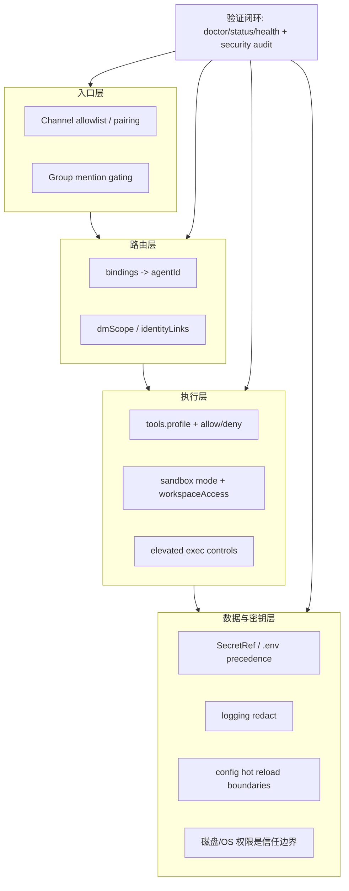

## 8.5 安全基线与审计流程

安全基线的目标是把高风险能力关进确定性的边界，并使每一次关键决策都可追溯、可复盘；只写一份“配置清单”做不到这一点。本节基于 OpenClaw 官方安全与配置文档，给出一套可落地的安全与审计流程：如何划分边界、如何记录审计事件、如何注入密钥，以及如何用自检命令把基线变成可验证的流程。

### 8.5.1 纵深防御的分层与验证

OpenClaw 的官方安全模型以 **“个人助手模型（trusted operator boundary）”** 为基础假设，并不原生提供抵御恶意多租户的硬隔离。未加硬性安全保护就把网关暴露给外界，系统的信任链会非常脆弱。

共享 secret token / password 鉴权的 Gateway HTTP 面（如 `/v1/chat/completions`、`/v1/responses`、`/tools/invoke`）应视为受信 operator 入口；一旦持有共享密钥，就不能依赖更窄的 `x-openclaw-scopes` 来实现多租户隔离。

智能体系统的风险来自“入口渠道 + 路由 + 工具 + 密钥 + 记忆”的组合链路，而非单一入口。纵深防御的最小可行分层为四层，每层都要定义可验证的控制点：

1. **入口层**：渠道门控、群聊触发规则、允许列表与提及规则。默认执行面应**极其保守**：建议把非主会话（如群聊）默认全部放入沙箱（Docker Sandbox），甚至设置 `workspaceAccess=none` 或只读，从而大幅降低 `allowFrom` 或 `dmPolicy` 配置放宽后凭据被越权获取的风险。
2. **路由层**：用绑定优先把高风险入口固定到受控智能体，避免把路由正确性变成概率问题。详见 [7.3 路由基础](../07_multi_agent/7.3_routing_basics.md)。
3. **工具层**：用工具策略做允许、拒绝与分层策略，拒绝规则优先于允许规则，避免因配置叠加导致越权。详见 [5.2 工具策略：允许、拒绝与分层策略](../05_tools_skills/5.2_tool_policy.md)。
4. 运行与数据层：把密钥改为环境注入（详见 [4.2 模型供应商接入与认证方式](../04_config_models/4.2_provider_access.md)），开启日志脱敏，把诊断输出落盘到可管控路径，并控制保留期与访问权限。

**安全分层与验证证据链示意：**



图 8-4：安全分层与验证证据链示意

验证这些分层是否生效，应优先使用系统自检与状态探测，不要先在生产入口“试一试”。hooks 入口也应纳入基线：默认不要允许外部请求自带 `sessionKey`；如确需放开，也要通过 `allowedSessionKeyPrefixes` 把可写入的 session key 约束在受控前缀内。推荐的最小验证组合如下：

```bash
openclaw doctor
openclaw status --deep
openclaw channels capabilities
openclaw models status
openclaw models status --probe
openclaw secrets audit  # 请以实际 CLI 版本为准
openclaw security audit  # 请以实际 CLI 版本为准
openclaw security audit --deep  # live Gateway probes + 插件安全采集
```

> **注意**：某些 CLI 命令（如 `openclaw secrets audit` 和 `openclaw security audit`）的可用性取决于版本。若命令不存在，查阅当前版本的官方文档或用 `openclaw --help` 确认可用命令。

普通 `security audit` 偏 cold/read-only 配置检查；`--deep` 会增加 live Gateway probes 和插件拥有的安全 collector。Hooks 入口也要检查：`hooks.token` 必须是非空、强随机值，并且不能复用 `gateway.auth.token`，当前安全审计会把 token 复用或过短作为风险项报告。

### 8.5.2 审计事件四元组

审计要回答的是：谁在何时通过什么入口做了什么，以及系统为什么允许或拒绝。为避免日志沦为无法检索的文本堆，建议把关键动作统一抽象为结构化审计事件，并固定四个字段维度：

1. 主体：用户、对端标识、渠道账号，以及被路由到的智能体标识。
2. 动作：工具名称、参数摘要、目标资源标识。
3. 依据：命中的绑定、命中的工具策略规则、以及拒绝原因。
4. 结果：成功、失败、被拒绝、需要人工确认。

OpenClaw 支持输出结构化日志，并提供日志跟随能力。排查“为何被拒绝”或“为何路由到某智能体”时，可先跟随日志流，再按字段过滤。下例从 JSON 日志中抽取与路由和工具调用相关的事件摘要。

```bash
openclaw logs --follow --json | jq -c 'select(.type=="log") | (.raw | fromjson? // {}) | select(.event=="routed" or .event=="tool_call" or .event=="blocked_tool_call" or .event=="tool_call_blocked") | {ts:(.time // .ts), traceId, spanId, event, agentId:(.agentId // .agent_id), channelId, peerId, tool, reason}'
```

> **注意：实际字段名以 `logs --json` 输出为准。** 当前结构化链路字段使用 `traceId` / `spanId` 这类 camelCase 命名；验收前仍建议先不加过滤打印一条原始日志，再用 `jq` 过滤。

如果发现“同一入口在不同时间触发了不同能力”，优先检查是否存在多账号配置、群聊策略差异或工具策略叠加导致的边界漂移。

### 8.5.3 密钥注入与爆炸半径控制

密钥治理的目标是限制泄露后的可用范围与可用时间。OpenClaw 的配置支持以 `${VAR}` 或 `SecretRef` 对象形式获取密钥，避免把明文密钥写进配置文件或提交到代码仓库。

> [!NOTE]
> OpenClaw 会从进程环境变量、当前目录 `.env`、以及 `~/.openclaw/.env` 读取变量引用，且遵循 **“`.env` 不覆盖已有环境变量”** 的优先级规则。

下例展示常见的密钥注入形态：可以使用简单插值，也可以用统一的 `SecretRef` 对象对接凭据管线。实际部署时建议为不同环境配置不同的 provider / id。

```jsonc
{
  secrets: {
    providers: {
      default: { source: "env" }
    }
  },
  models: {
    providers: {
      "custom-proxy": {
        baseUrl: "https://my-proxy.internal/v1",
        api: "openai-completions",
        apiKey: { source: "env", provider: "default", id: "OPENAI_API_KEY_STAGING" },
        models: [{ id: "team-fast", name: "Team Fast Model", input: ["text"] }]
      }
    }
  }
}
```

控制爆炸半径通常需要三条硬规则：

1. 入口隔离：群聊与私聊使用不同的策略与默认智能体，避免低可信入口直接触发写入能力。
2. 权限隔离：高风险工具只允许出现在少数受控智能体的工具组里，并通过拒绝规则兜底。
3. 密钥隔离：不同能力使用不同密钥或不同权限范围的凭据，避免“一个密钥通吃全系统”。

### 8.5.4 反面案例：智能体自改配置导致的故障循环

即使做好了上述隔离，若核心配置文件（如 `openclaw.json`）缺少读写防护，仍可能发生严重的工程事故。

> [!CAUTION]
> **警惕智能体配置自我修改失效**：在一个真实案例中，用户赋予了智能体全局文件系统的读写权限。系统出现故障时，智能体产生“自我修复”幻觉，开始修改自己的 `openclaw.json`。
>
>
> 由于它并不完全理解参数格式，配置被改错。OpenClaw 监测到配置变更后自动重启，启动后又因配置错误崩溃；若进程守护再次将其拉起，就会陷入无限报错循环，最坏情况下会耗费大量日志空间或调用配额。

**防护建议：**

1. 生产环境中，**不要关闭进程的用户级权限限制**。运行 OpenClaw 的用户账号不应该对配置文件所在的目录具有写入权限（可以由部署流水线或其他专门的账号管理）。
2. 控制配置热重载的边界及行为。调整前参考官方设定：

| 概念 | 配置字段 | 默认值 | 别名或补充说明 |
| --- | --- | --- | --- |
| 配置热重载模式 | `gateway.reload.mode` | `hybrid` | 可选值：`hybrid`（默认，自动判断热重载或重启）、`hot`、`restart`、`off`。`debounceMs` 默认 300ms。旧版可能提及的 `autoRestartOnConfigChange` 为不存在或弃用的字段。 |

在 `openclaw.json` 中可设置 `gateway.reload.mode: 'hot'`，或设为 `'off'` 完全关闭文件监听，以免“修改后立即引发系统频繁异常重启”。
3. 用文件系统与执行层限制保护配置路径，例如 `tools.fs.workspaceOnly`、`tools.exec.applyPatch.workspaceOnly`、部署账号权限和只读挂载；`tools.deny` 只能拒绝工具名或工具组，不适合写成路径级 ACL。
4. 确需修改配置并排障时，推荐使用传统的运维配置下发方案，不要让 OpenClaw 修改自身配置。

### 8.5.5 安全演练与回归验证

安全基线不经演练，就会在变更中失效。建议把验证分为三类：

1. 自检回归：每次发布与配置变更后，固定跑一组命令，确保核心链路可用且边界未漂移。
2. 故障注入：在受控环境中故意引入无效密钥、断网、或渠道不可用，观察系统是否给出明确的错误与降级路径。
3. 事件响应：发现疑似泄露或越权后，按“检测/分级/指派 owner/止血/修复/发布验证/复盘”的流程推进，不能只做本地 key 轮换。

自检回归可以从最小组合开始：

```bash
openclaw doctor
openclaw health --json
openclaw status --deep
openclaw security audit --deep  # live Gateway probes + 插件 collector
openclaw secrets reload
```

> **版本提示**：`openclaw secrets reload` 和 `openclaw security audit` 命令的名称和参数在不同版本可能有差异。命令执行失败时，用 `openclaw --help` 或查阅当前版本文档获取正确的命令语法。

发现异常时，先用 `doctor` 与 `status` 判断问题出在配置、依赖还是运行时状态，再根据日志中的 `traceId` 回放定位。涉及敏感信息的日志与诊断输出，务必按官方安全建议开启脱敏并屏蔽环境变量输出，以免“排障数据”成为新的泄露通道。相关建议见 OpenClaw 官方文档的安全章节。
