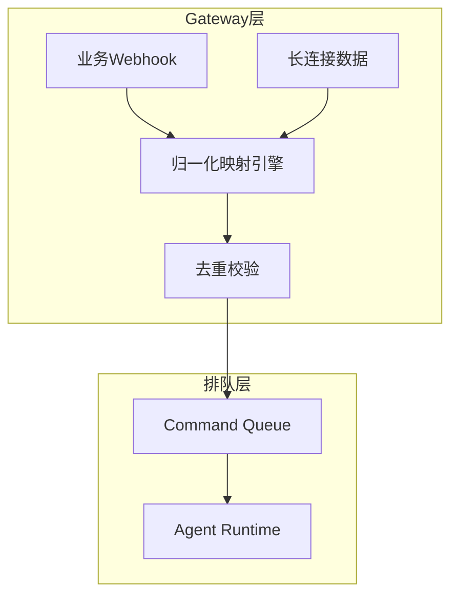
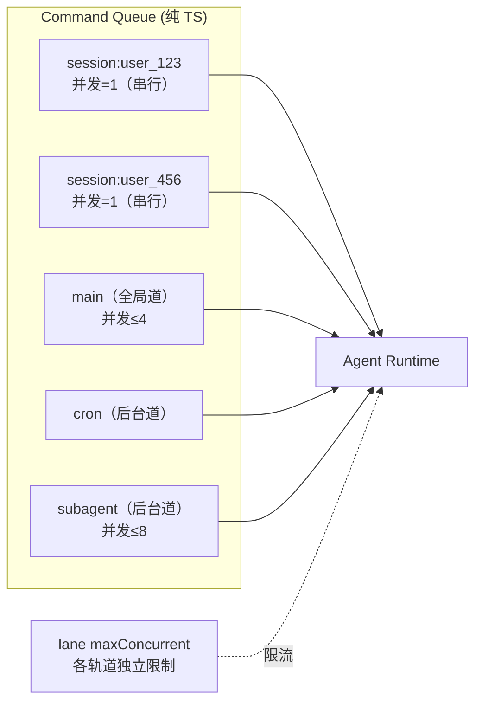

## 10.3 入口、排队与并发控制

本节讨论 Agent 循环最外围的保护层：入口治理。大模型调用昂贵，且极易受到长尾延迟攻击，因此把渠道事件归一化、用分道队列实现并发控制与反压，是防止系统雪崩的第一道防线。

### 10.3.1 协议归一化：渠道异构数据到统一事件

任何 Agent 框架若把原始通信渠道（如 Slack、微信、HTTP 请求包）的数据直接传入推理上下文，都难免陷入逻辑混乱。渠道有自己的一套概念（提及、多端同步、撤回等），与 Agent 需要的干净“任务域”并不匹配。

归一化（Normalization）是必经的第一步。网关不只是透传，还要剥离异构的通信噪音，将其转换为系统内部的标准事件格式，最终形成一个绑定会话的调度任务。这一过程确定以下核心属性：

- **会话键（Session Key）**：上下文锁定标识，确保连续请求不会跨会话污染。
- **意图标定（Intent）**：路由面或业务面，系统将根据此字段调度优先级。
- **预算约束（Budget）**：包括超时时间、最大模型调用次数等限制，使超支任务能被执行器终止。



图 10-5：入口从异构通道事件到归一化调度任务的漏斗效应

这一架构的硬性验收准则是：线上任一渠道产生的交互，都应解析为可结构化追溯的标准事件，并携带足够的事件 ID、会话键、trace 与日志上下文，便于排障时重建链路。能否“单独重放”取决于具体渠道、外部副作用和工具幂等性，并非所有入口的通用保证。

### 10.3.2 幂等控制：请求去重与副作用屏障

在传统 Web 开发中，只有 POST 或 PUT 等修改请求才需要谨慎处理幂等性。在 Agent 架构内部，即使看似“查询”的请求，也可能使 Agent 自发调用高危变更工具（如操作测试环境、调用付费 API）。

因此，Agent 侧必须在工具分发之前对重复投递实现物理级防并发。常见的两层策略是：

- **粗粒度请求去重（去重窗口）**：通道端因网络抖动在短时间内发送相同事件标识时，系统拦截重复投递，并返回之前缓存的状态结果。
- **细粒度副作用屏障**：Agent 即将执行带有变更性质的工具时，在缓存中标记写屏障。此后同一任务若从入口重新流转，会被屏障拦截，不会无差别地重新推理。

### 10.3.3 Command Queue：纯 TypeScript 的分道排队

OpenClaw 的排队层采用**纯 TypeScript 实现，不依赖 Redis 或其他外部中间件**，完全基于 Promise 实现并发控制。这一设计降低了部署复杂度，单节点部署即可获得完整的排队能力。

队列采用**分道（Lane）** 架构，每条道独立维护 FIFO 排队和并发上限：

- **会话道（Session Lane）**：以 `session:<key>` 为标识，保证同一会话的多次请求严格串行执行。这是最重要的隔离机制，使同一用户的连续消息不会相互干扰。
- **全局道（Global Lane）**：进程级并发控制，默认 `main` 道的并发上限为 4。未显式配置的道默认并发上限为 1。
- **后台道（Background Lane）**：`cron` 和 `subagent` 等独立执行轨道，默认 `subagent` 道的并发上限为 8，保证定时任务和子智能体不会被业务流量饿死。

`agents.defaults.maxConcurrent` 主要决定默认 main lane 的并发上限；cron、subagent 等后台 lane 有各自的并发控制（例如 cron run 限制与 subagent resolver 限制）。因此它不是覆盖所有执行轨道的统一全局上限。



图 10-6：Command Queue 分道排队与分轨并行度控制

### 10.3.4 反压与超时

外部负载过高时，系统应主动、快速地向客户端返回拒绝，避免连接永久悬挂。OpenClaw 的反压机制体现在以下层面：

- **队列深度限制**：消息队列默认有容量上限，默认 drop 策略更偏向 summarize；只有配置为 `drop: "new"` 等策略时，新请求才会直接收到拒绝响应。
- **会话写锁**：同一会话同一时刻只有一个操作可以修改状态（session write lock），后续请求在队列中等待。
- **任务超时**：命令队列暴露 `warnAfterMs`、`onWait` 与 `taskTimeoutMs` 等控制点；超时主要约束已出队执行的任务，并非“排队等待超时后自动驱逐”的通用保证。

在排队调度中，超时既表示错误，也是系统的自我保护手段。反压功能的验收底线是：十倍峰值压测下系统不 OOM，队列容量和 drop 策略符合预期，长任务受 `taskTimeoutMs` 等预算约束，不产生僵尸进程。

### 10.3.5 基于日志的链路排障

没有可客观定位问题的日志流水线，排队与并发控制就无从验证。工程师应围绕系统透传的 Trace 与事件变化，收集以下基础数据，搭建可诊断的监控大盘：

- **饱和度维度**：当前积压总数、各道队列占用比例、入口拒绝频率。
- **延迟维度**：排队等待时间、首次模型调用延迟、请求端到端总延迟。

下例用 jq 过滤结构化日志中的归一化信息及生命周期节点，判断瓶颈来自入口分配还是下游供应商：

```bash
openclaw logs --follow --json | jq -c 'select(.type=="log") | (.raw | fromjson? // {}) | select(.traceId=="t-78ab-09f1") | {time, traceId, level: ._meta.logLevelName, msg: .["0"]}'
```

经过入口层，从通道投递进来的信号被归一化为统一的、受限流约束的管理对象。下一节讨论系统如何为模型组装所需的上下文，即提示词装配。
