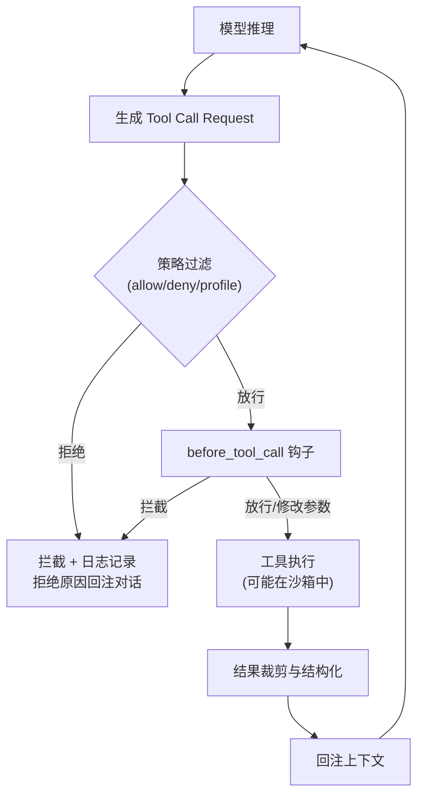

## 10.5 工具执行与结果回注

智能体系统的关键能力，是把自然语言编排转化为对物理世界产生可验证影响的动作。在 OpenClaw 看来，这也是系统最容易出问题的环节：每一次工具调用，都是从概率性的模型推理跨到确定性的物理副作用。

本节按工具调用的全生命周期，拆解从模型提议到策略过滤、实际执行、结果回注的完整链路。

### 10.5.1 工具：带类型签名的可调用函数

在 OpenClaw 中，工具（Tool）的定义是一个**带类型签名的可调用函数**。每个工具具有名称、参数结构（JSON Schema）、调用协议以及可选的安全标签。模型在推理过程中若决定调用工具，会生成一个包含工具名和参数的结构化请求（Tool Call Request）。

工具调用经历以下四个阶段：

1. **意图提议（Proposing）**：模型生成格式化的工具调用请求，控制流回到执行内核。
2. **策略过滤（Policy Filtering）**：系统检验该工具是否在当前策略允许范围内（`tools.allow` / `tools.deny`、工具档案 `tools.profile`、发送者限定 `toolsBySender`、以及当前版本里额外存在的 `tools.elevated.*` 高权限执行门控）。任何越权探测都在这一步被立即阻断，无须消耗模型算力。
3. **实际执行（Execution）**：通过安全检查的工具调用请求被分发到对应的执行器，可能运行在沙箱环境中。
4. **结果回注（Result Injection）**：工具返回的结果经过裁剪和结构化处理后，回注到对话上下文供模型继续推理。



图 10-10：工具调用的完整生命周期

### 10.5.2 before_tool_call 钩子：插件级的动态拦截

在策略围栏之外，OpenClaw 还提供了更灵活的拦截层：**before_tool_call 钩子**。它允许插件在工具执行前介入，实现策略引擎难以表达的动态逻辑（如基于运行时状态的条件拦截）。关于钩子系统的完整说明，见 [12.1.4 Hook 架构](../12_extension_engineering/12.1_plugin_architecture.md)。

钩子在每次工具调用前运行，可以做两件事：

- **拦截执行**：返回 `{ block: true, blockReason: "..." }`，工具调用被终止，拒绝原因回注到对话中。
- **修改参数 / 要求审批**：返回 `{ params: { ... } }` 或审批请求，运行时会把最终 hook 结果合并到当前参数上；多个 `before_tool_call` handler 的结果由 Hook Runner 合并，参数字段采用后定义覆盖。若某个插件先提出 `requireApproval`，后续其他插件不能再改写该 approval 插件冻结下来的参数；但后续更低优先级 handler 仍可返回 `block: true`，阻断审批路径。

插件声明 `before_tool_call` 钩子即可参与拦截链。一个典型的内建应用是**循环检测**：系统发现智能体反复以相似参数调用同一工具时，钩子将其标记为 `stuck`，并根据严重程度（`critical` 拦截 / `warn` 告警）决定是否阻断。

调整后的参数按工具调用 ID 在运行期记录，供后续执行和诊断链路使用；不要把某个固定缓存容量当作外部契约。

### 10.5.3 拦截体系：以策略围栏兜底

把外部世界的操作权委托给概率性的大模型，必然伴随风险。工程上，在策略过滤层建立确定性规则，永远优于在提示词中反复嘱咐模型“不要做危险操作”。

所有具有外部副作用的工具（如发送邮件、更新数据库、重置云主机等写操作），都应默认放入 `tools.deny` 禁止名单，仅在满足以下条件时放行：

- 通过 `toolsBySender` 限定可触发的用户范围。
- 对宿主机命令执行类能力，再叠加 `tools.elevated.enabled` / `tools.elevated.allowFrom` 之类的高权限门控，堵住“工具已允许，但提权执行仍应被拦截”的缺口。
- 配合人工确认流（Human-in-the-Loop），关键操作必须获得人工审批后方可执行。

根据官方文档，部分工具被硬编码为不可通过外部 API 调用（如 `cron`、`sessions_spawn`、`gateway`、`whatsapp_login`），这些限制独立于用户配置的策略规则。关于工具策略的详细配置方法，参见 [5.2 工具策略](../05_tools_skills/5.2_tool_policy.md)。

### 10.5.4 结果回注：裁剪大尺寸工具结果

工具执行完成后，若把大量原始输出直接回注到会话上下文，上下文窗口会被低价值数据占满，早期的关键指令与决策信息被挤出，这就是“上下文淹没”问题。例如，一次 Shell 命令返回十万行 `nginx` 错误日志，直接注入上下文会使模型完全丧失对之前任务的记忆。

结果回注环节应严格遵循以下三条策略：

- **结构化摘要优先**：从工具结果中提取关键字段与结论性摘要回注上下文，不返回完整原始输出。
- **强制截断兜底**：设定动态结果体积上限；当前 live 路径默认硬上限约 16K 字符，并结合上下文窗口占比与 agent context 限额进一步收紧。超出部分截断并插入占位说明，使模型知道数据已被裁剪。
- **外部存储引用**：对于大体量结果，不回注原始内容，只返回存储路径引用（如“扫描结果已存储至 `/tmp/scan_result.log`，如需详细查看请重新读取”）。

已经膨胀的会话上下文，还可通过 `contextPruning` 机制自动裁剪，详见 [6.4 压缩与裁剪](../06_context_memory/6.4_compaction_pruning.md)。

### 10.5.5 排障方法：基于事件日志追溯

工具调用的每个阶段都落盘为独立事件，排障时可直接依据事件时间线定位故障点，无须猜测或仅凭对话表面反应判断。

建议按以下顺序排查：

1. 用 `openclaw sandbox explain` 检查当前智能体/会话的有效工具与沙箱策略；用 `openclaw status --deep` 只确认 Gateway、渠道与系统探针是否健康。
2. 用 `logs --follow --json` 按 `traceId` 筛选事件流，确认工具调用请求是否已发出、是否被策略拦截，以及工具结果是否已回注。
3. 用 `doctor` 检查系统依赖与网络连通性，排除基础设施层面的故障。

```bash
openclaw status --deep
openclaw logs --follow --json
openclaw doctor
```

下一节讨论流式输出与重试策略，二者共同保证长链路任务在遭遇外部故障时仍能可控降级。
