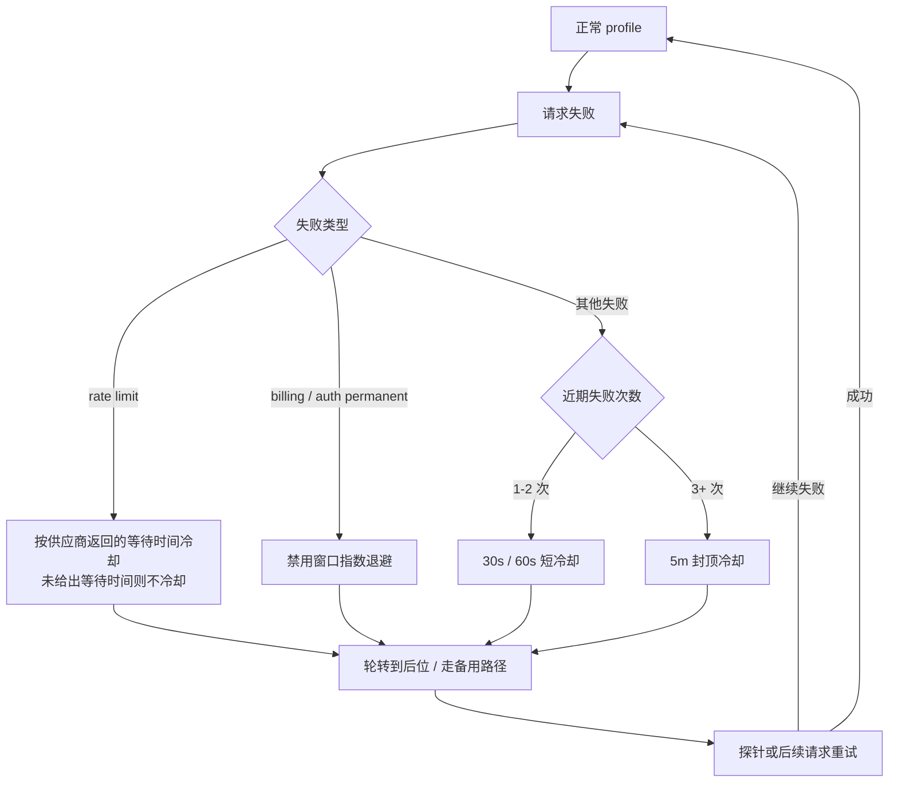

## 11.2 冷却与禁用：故障窗口内的止血机制

本节讨论 **auth profile 层面**的冷却与禁用机制：某个 API key 或 OAuth profile 持续报错时，系统如何自动退避并轮换，防止重试放大。模型级的跨模型回退（`fallbacks`）见 [11.3](11.3_fallback_rules.md)。

### 11.2.1 冷却解决什么：防止重试放大

供应商抖动或限流时，如果系统持续对同一目标重试，就会形成放大链条：失败触发重试，重试挤占并发与配额，队列堆积导致端到端超时。

冷却的目标是在故障窗口内减少无效尝试，把资源留给仍可能成功的路径。

### 11.2.2 Auth Profile 冷却：官方分级机制

OpenClaw 在 auth-profiles 层面内置了冷却分级机制。某个 auth profile（API key 或 OAuth）报错时，冷却方式取决于失败类型：限流（rate limit）只按供应商返回的等待时间冷却；billing 与 auth permanent 进入指数退避的禁用窗口；其余失败走按次数递增的短阶梯冷却，并在 profile 轮转时将冷却中的 profile 移至末位。参考：https://docs.openclaw.ai/concepts/model-failover

其状态迁移链如下：



图 11-3：Auth profile 冷却与禁用的状态迁移

**冷却分级（按失败次数递增）：**

下表只适用于限流、billing 与 auth permanent 以外的失败。限流不走这套阶梯：只有供应商给出等待时间（`Retry-After`、`retry-after-ms`、错误正文中的重试提示，或额度桶的重置时间）时，profile 才进入冷却，时长与之相同；供应商未给出时，profile 在下一回合仍可用，本回合照常轮转到其他 profile 或模型。重复或并发的限流不会延长冷却。

| 失败次数 | 冷却时长 |
|----------|------------------------|
| 1 次 | 30 秒 |
| 2 次 | 1 分钟 |
| 3 次 | 5 分钟 |
| 4+ 次 | 5 分钟封顶 |

“凭据/profile 持久化”与“运行期 auth 路由状态”应分开理解：`auth-profiles.json` 保存认证档案本身，运行期冷却、禁用与路由状态则独立管理，不应再写成 `auth-profiles.json` 的字段。

```json
{
  "usageStats": {
    "provider:profile": {
      "lastUsed": 1736160000000,
      "cooldownUntil": 1736160060000,
      "errorCount": 2
    }
  }
}
```

**Billing disable 退避（计费错误专项）：**

- 起步禁用 10 分钟，之后每次 billing 失败翻倍，上限 24 小时；认证永久错误（`auth_permanent`）同样从 10 分钟起步，上限 1 小时。
- `disabledReason: "billing"` 单独标记，与普通冷却区分。
- 24 小时内无失败则计数重置。

以上冷却梯度、禁用窗口与计数重置窗口都是内置策略，当前配置 schema 中没有 `auth.cooldowns.*`，旧配置中的该块会被 `config validate` 拒绝。需要影响轮转结果时，应调整 `auth.order` 中的 profile 顺序或模型回退链（见 [11.3 节](11.3_fallback_rules.md)）。

### 11.2.3 验收与排障

- 回退频繁发生但主链路看起来正常时，优先检查运行期 auth state 中的 `cooldownUntil`、`errorCount` 与禁用原因，确认是否存在持续触发冷却的 profile。
- 如果 billing disable 持续触发，检查 `disabledReason`，先处理供应商侧的余额或额度问题；退避时长为内置策略，不能通过配置调整。
- 故障已恢复但仍长时间走备用链路时，检查 `cooldownUntil` 时间戳是否已过期；已过期仍未恢复的，用探针命令主动验证。

操作示例：

```bash
openclaw models status
openclaw models status --probe
openclaw status --deep
```
