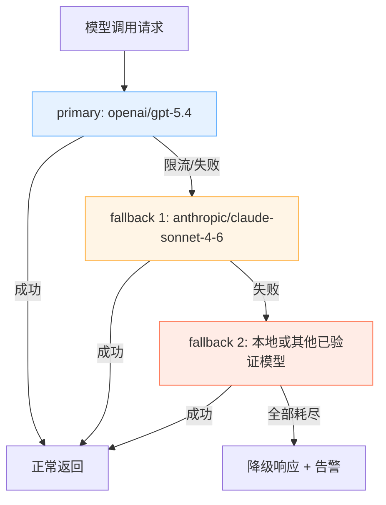

## 11.3 模型回退链路与错误分流

本节把“失败如何处理”落到官方 failover 规则上：用 `fallbacks` 字符串列表声明按顺序尝试的回退目标，并把错误分流为可执行的动作，而不是笼统地“重试一下”。重点包括回退链路的可解释性、证据链字段，以及通过故障注入证明回退确实生效。回退配置的基础结构见 [4.4 故障转移基础](../04_config_models/4.4_failover.md)。

### 11.3.1 回退目标：连续性优先但要可解释

回退通常以服务连续性优先，但不能变成无声切换，否则输出质量下降、成本上升时无从定位原因。

建议每次回退至少记录：

- 触发原因：错误类型与原始目标。
- 命中规则：命中的回退顺序与策略版本。
- 回退路径：从哪个模型切到哪个模型。
- 后续动作：是否进入退避、限流保护或人工介入。

### 11.3.2 规则设计：按顺序分流

错误分流除了依靠失败后的切换，更要依靠重试预算的设置。全局默认 `agents.defaults.model.fallbacks` 是按顺序尝试的回退链，因此备用模型需按可靠性排序：

- `primary`：优先使用的主力提供商模型。
- 第一回退：同供应商小模型（应对主模型并发限流）。
- 第二回退：备用供应商对应模型（应对主供应商网络或 API 错误）。

覆盖规则也要写清：显式 fallback override 会替换全局默认链，空数组可用于禁用全局回退；如果某个 job / session / agent 只覆盖 primary 而没有 fallback override，系统可能把配置中的 primary 作为恢复探针候选追加到尝试链末尾。因此不要把所有路径都简化为固定的 `primary -> fallbacks[]`。

回退链路的决策逻辑如下：



图 11-4：模型回退链路的决策逻辑

示例：

```javascript
{
  agents: {
    defaults: {
      model: {
        primary: 'openai/gpt-5.4',
        fallbacks: [
          'anthropic/claude-sonnet-4-6', // 应对跨供应商网络或架构故障
        ],
      },
    },
  },
}
```

两层机制的关系是：auth profile 冷却（[11.2](11.2_rotation_cooldown.md)）优先在同一 provider 内轮换 profile，模型 fallback 则在模型之间跨级切换。“先走 auth 层轮换”不等于“必须把所有 profile 都耗尽”：对于 overloaded / rate-limit 这类瞬时错误，系统先消耗 `overloadedProfileRotations` / `rateLimitedProfileRotations` 预算，预算耗尽后即可进入模型级 fallback。OpenAI agent 模型引用使用 `openai/*`；ChatGPT/Codex 订阅 OAuth 由 Codex/OpenAI auth profile 与运行时策略表达凭据和执行路径，历史 `openai-codex/*` 模型引用应通过 `openclaw doctor --fix` 迁移。

### 11.3.3 影响排障的回退行为

以下回退行为细节直接影响排障判断：

**上下文溢出错误不触发回退。** 系统检测 `request_too_large`、`context_window_exceeded` 等错误模式，一旦识别为上下文溢出，直接抛出错误而不尝试回退，因为更小的备选模型只会更快失败。此时应触发压缩（Compaction），而不是换模型。

**冷却期间的探针机制。** 候选模型或 profile 处于临时冷却时，系统可能在冷却即将到期时进行受限探针；探针按 provider / fallback run 节流，并非固定每 30 秒轮询。这避免了“冷却刚过就瞬间全量恢复”导致的流量尖峰，实现类似断路器“半开”状态的渐进恢复。

**计费错误的指数退避公式。** 公式为 `baseMs × 2^(min(disableCount-1, 10))`，其中 `disableCount` 来自当前禁用原因对应的 failure count，时长上限为 `billingMaxHours`（默认 24 小时）。计费冷却的退避曲线比通用冷却更陡峭，因为计费问题通常需要人工介入才能恢复。

**聚合型供应商旁路。** 部分聚合型模型供应商（如 OpenRouter 等）自身有内部的供应商轮转机制，默认跳过 auth 冷却检查。使用这类聚合服务时，OpenClaw 的冷却策略不生效。

**错误原因归因。** 所有 profile 都不可用时，系统先按错误原因的出现情况打分，再用优先级链做并列裁决：`auth_permanent` > `auth` > `billing` > `format` > `model_not_found` > `overloaded` > `timeout` > `rate_limit` > `empty_response` > `no_error_details` > `unclassified` > `unknown`。这一结果决定对外暴露的错误类型和建议操作。

### 11.3.4 验证方法：故障注入加日志对账

回退写进配置并不算完成，必须验证它确实会触发。

1. 基线通过：`models status` 没有认证缺失/过期，`models status --probe` 的 live auth 探针正常。
2. 制造故障：触发限流或人为制造网络/上游 API 错误。
3. 观察日志：出现回退事件，并且命中目标与配置一致。

```bash
openclaw models status
openclaw models status --probe
openclaw logs --follow --json
```

如果日志中无法对账回退原因，应优先补齐结构化日志字段与审计，不要继续加规则。
