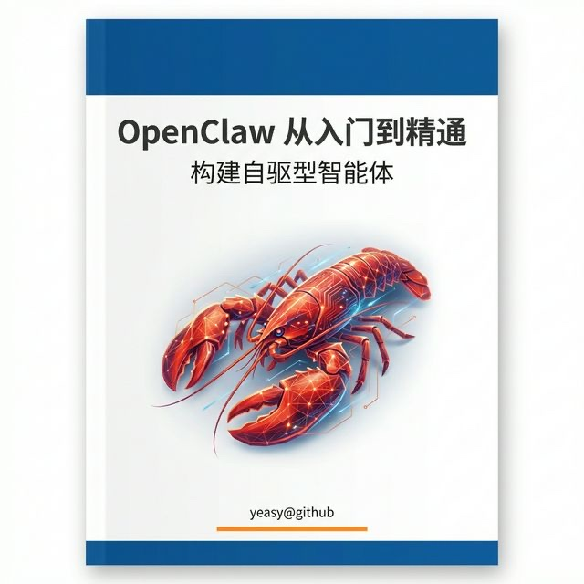

# OpenClaw: Beginner to Expert

This page is an English overview. The full book is in Chinese.

**[Read Chapter 1 in Chinese on GitBook](https://yeasy.gitbook.io/openclaw_guide/di-yi-bu-fen-ji-chu-ru-men/01_overview)**

[中文首页](README.md) · [Contents in Chinese (GitHub)](https://github.com/yeasy/openclaw_guide/blob/main/SUMMARY.md) · [Chinese PDF (releases)](https://github.com/yeasy/openclaw_guide/releases/latest)



## Highlights

**[OpenClaw](https://github.com/openclaw/openclaw) is an open-source, local-first personal AI assistant**, created by Peter Steinberger. This book provides a comprehensive guide from getting started to production deployment, with deep dives into the underlying mechanisms and implementation principles.

- **Hands-on**: Build a minimal working loop from scratch, with ready-to-use configuration templates
- **Deep Dives**: Detailed analysis of Gateway, Agent Loop, tool system, sessions and memory
- **Production-Ready**: Focus on reliability, security hardening, monitoring and troubleshooting

## Target Audience & Prerequisites

- **Target Audience**: Individual users interested in AI agents, AI application developers, LLM engineers, system architects, etc.
- **Prerequisites**: Basic backend development familiarity is expected, such as Node.js or Python fundamentals. If you are new to LLMs and AI agents, see [AI Beginner Guide](https://github.com/yeasy/ai_beginner_guide) and [Agentic AI Guide](https://github.com/yeasy/agentic_ai_guide).

## Book Structure

| Part | Chapters | Overview |
|------|----------|----------|
| Part 1: Getting Started | Ch 1–4 | Overview, setup, first conversation, configuration & model access |
| Part 2: Advanced Usage | Ch 5–8 | Tools & skills, context memory, multi-agent collaboration, automation & ops |
| Part 3: Internals & Engineering | Ch 9–12 | Gateway protocol, Agent Loop internals, reliability, plugin extensions |
| Part 4: Practice & Optimization | Ch 13–16 | Case studies, performance & cost optimization, troubleshooting, AI ecosystem integration |
| Appendix | — | Glossary, config templates, troubleshooting checklist, API reference, command cheatsheet, version mapping, further reading, environment self-check tool, naming history, volatile facts table |

## Local Preview

This repository uses mdPress for building. For local preview:

```bash
brew tap yeasy/tap && brew install mdpress
mdpress serve
```

Other Markdown previewers can be used as auxiliary tools, but they are not the standard build chain for this repository.

## 5-Minute Quick Start

New to OpenClaw? Just three steps:

1. **Install** (1 min): `curl -fsSL https://openclaw.ai/install.sh | bash -s -- --no-onboard` (locked-down environments should download and inspect the script first, or use the official manual/npm path)
2. **Initialize** (2 min): `openclaw onboard --install-daemon` → follow the wizard to configure your model API key and install the background service
3. **Chat** (2 min): Run `openclaw dashboard`, type "hello" in the Control UI chat, receive an AI response — you're done! 🎉

See [Chapter 2: Setup](02_setup/README.md) and [Chapter 3: First Conversation](03_minimal_loop/README.md).

## Learning Paths

Different readers can choose their path:

| Role | Core Chapters | Est. Time | What You'll Achieve |
|------|--------------|-----------|-------------------|
| Individual User | 1→2→3→5→7 | 3-4 hours | Build a personal WhatsApp/Telegram AI assistant |
| App Developer | 1-7→12 | 8-10 hours | Develop custom tools, skills and multi-agent systems |
| Ops Engineer | 2→3→8→11→14→15 | 6-8 hours | Production deployment, security hardening & troubleshooting |
| Architect | 1→9→10→12→16 | 6-8 hours | Understand internals, design enterprise-grade agent architecture |

## Related Books

This book is part of an AI technology series:

| Book | Relationship |
|------|-------------|
| [AI Beginner Guide](https://github.com/yeasy/ai_beginner_guide) | Zero-to-one AI introduction |
| [Prompt Engineering Guide](https://github.com/yeasy/prompt_engineering_guide) | Agent prompt design fundamentals |
| [Context Engineering Guide](https://github.com/yeasy/context_engineering_guide) | Context management & memory architecture |
| [Claude Guide](https://github.com/yeasy/claude_guide) | Claude MCP protocol, tools & Agentic Coding |
| [Agentic AI Guide](https://github.com/yeasy/agentic_ai_guide) | General agent architecture & multi-agent patterns |
| [AI Security Guide](https://github.com/yeasy/ai_security_guide) | Agent security design & attack/defense practices |
| [LLM Internals](https://github.com/yeasy/llm_internals) | Deep dive into LLM architecture |

## Contributing

Welcome to submit [Issues](https://github.com/yeasy/openclaw_guide/issues) or [PRs](https://github.com/yeasy/openclaw_guide/pulls). Especially welcome: typo fixes, broken link repairs, case study additions, and reusable templates.

## License

This book is licensed under [CC BY 4.0](https://creativecommons.org/licenses/by/4.0/).
